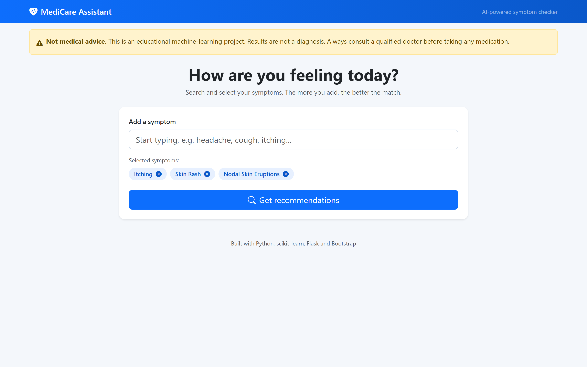
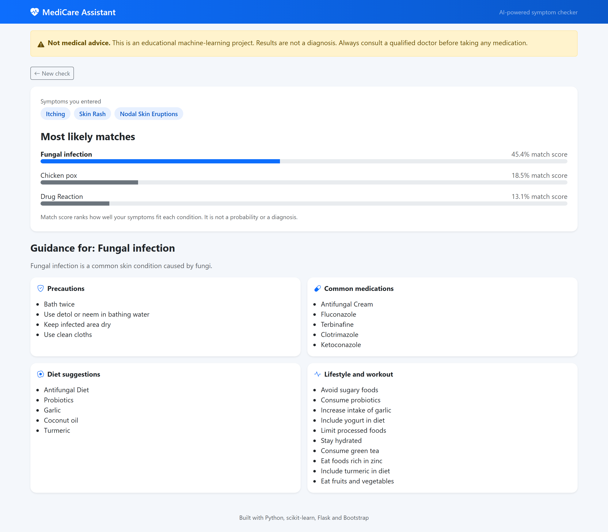
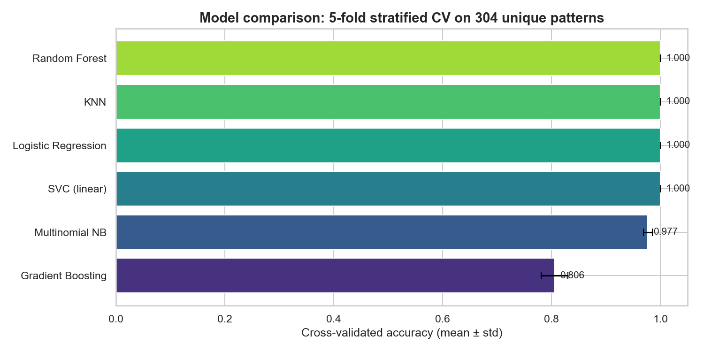
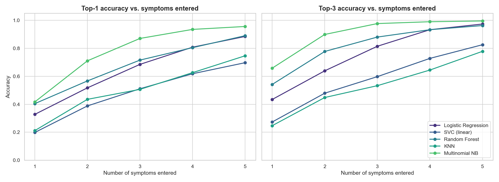

# 🩺 Medicine Recommendation System

A machine-learning web app that predicts likely conditions from a user's symptoms and provides guidance: description, precautions, common medications, diet and lifestyle suggestions.

> ⚠️ **Disclaimer:** This is an educational project. It is **not** a medical diagnosis tool. Always consult a qualified doctor before taking any medication.

## Screenshots

| Symptom input | Results |
|---|---|
|  |  |

## Features

- Search and select from 131 symptoms with live suggestions
- Top-3 most likely conditions with a match score
- Guidance for the best match: description, precautions, medications, diet, workout
- Responsive Bootstrap 5 interface with a medical disclaimer on every page

## Tech stack

Python · pandas · NumPy · scikit-learn · Flask · Bootstrap 5 · Jupyter

## Project structure

```
medicine-recommender/
├── app.py                 # Flask backend
├── notebook.ipynb         # Data cleaning, model comparison, training
├── requirements.txt
├── data/                  # Source CSV files (Kaggle)
├── models/                # Trained model + lookup files
├── templates/             # HTML pages (base, index, result)
├── static/css/style.css
└── screenshots/
```

## Dataset

Kaggle "Medicine Recommendation System Dataset": 41 diseases, 131 symptoms, plus description, precaution, medication, diet and workout tables.

## Data cleaning decisions

| Issue | Fix |
|---|---|
| 4,616 of 4,920 training rows were exact duplicates (only **304 unique** symptom patterns) | De-duplicated before modelling to avoid train/test leakage |
| Disease name typos (`Peptic ulcer diseae`, double space in the vertigo name) | Standardised across all tables |
| Symptom name typos (`dischromic _patches`, `foul_smell_of urine`, `spotting_ urination`) | Renamed to match the severity file |
| `fluid_overload` appeared twice and the copies differed in 114 rows | Merged with logical OR |

## Model selection

**1. Standard evaluation (5-fold stratified cross-validation, 304 unique patterns)**

Linear SVC, Logistic Regression, Random Forest and KNN all scored 100%; Multinomial Naive Bayes 97.7%; Gradient Boosting 80.6%. The perfect scores come from the synthetic nature of the dataset: each row is a subset of a disease's characteristic symptom set, so full symptom sets are easy to match. This ties four models and says little about real use.



**2. Robustness test (realistic input)**

Real users enter only a few symptoms, so held-out rows were masked to keep only 1-5 randomly chosen symptoms, then scored on top-1 and top-3 accuracy.

| Symptoms entered | 1 | 2 | 3 | 4 | 5 |
|---|---|---|---|---|---|
| **Naive Bayes top-3** | 65.8% | 89.9% | 97.7% | 99.0% | 99.6% |
| Random Forest top-3 | 54.2% | 77.7% | 88.0% | 93.3% | 96.3% |
| Logistic Regression top-3 | 43.4% | 63.9% | 81.5% | 93.3% | 97.4% |

**Multinomial Naive Bayes** was selected: it leads at every level of partial input. The app shows the top 3 matches for this reason.



## Limitations

- The dataset is synthetic and small (304 unique patterns), so reported accuracy does not reflect clinical performance.
- With one symptom entered, top-1 accuracy is only about 42%. Many diseases share symptoms.
- The match score is a ranking signal, not a calibrated probability.
- Medication lists are informational and are not prescriptions.

## Run locally

```bash
git clone https://github.com/Harris-Majeed/medicine-recommender.git
cd medicine-recommender
pip install -r requirements.txt
python app.py
```

Open http://127.0.0.1:5000

To retrain, run `notebook.ipynb` from top to bottom; it regenerates the files in `models/`.

## Author

**Haris Majeed**, AI Engineer & Data Scientist

[LinkedIn](https://www.linkedin.com/in/haris-majeed-896550203/) · [GitHub](https://github.com/Harris-Majeed) · [Portfolio](https://haris-majeed.vercel.app/)